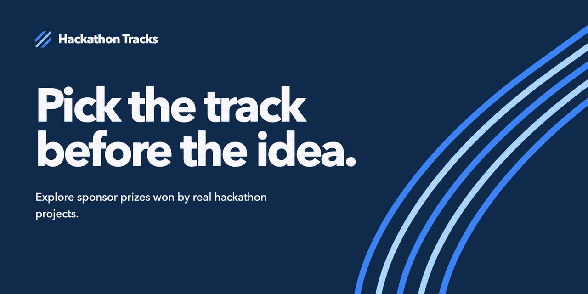

# Hackathon Tracks

Browse past hackathon winners by sponsor and see what they built before you pick your next project.

<!-- BEGIN coverage -->

   

<!-- END coverage -->

**[Star this repo](https://github.com/azizu06/hackathon-tracks)** to save it for your next hackathon.

**[Open the searchable site](https://tracks.azizu.dev/)** · [Site preview](docs/tracks-preview.webp) · [CSV](winners/winners.csv) · [JSON](winners/winners.json)

## Contents

[Start here](#start-here) · [Track-first method](#the-track-first-method) · [Leaderboard](#leaderboard) · [Sponsors](#sponsor-index) · [Hackathons](#hackathon-index) · [My three wins](#my-three-wins) · [Contributing](#contributing) · [License](#license)

## Start here

1. **Find your hackathon's sponsors.** Check the current Devpost and event site for tracks, required integrations, and judging criteria. Use the [hackathon index](#hackathon-index) to see who awarded prizes at past editions.
2. **Open a sponsor's page.** Search the [sponsor index](#sponsor-index), then compare winners' projects, integrations, and demos.
3. **Borrow what worked.** Put your ideas in the [track matrix](templates/track-matrix.md) or run the [track-picker prompt](prompts/track-picker.md) in Claude Code or Codex. Pick the smallest build you can demo that fits the tracks you want to enter.

## The track-first method

Put the tracks in rows and your ideas in columns. Give each idea a 0 if it misses a requirement, a 1 if the fit depends on something you still need to verify, or a 2 if you can show the integration working in the demo. Set aside ideas that fit zero tracks. If an idea only has 1s, test the most important assumption first.

Aim for one build that fits two to four tracks. Each sponsor integration should do something the user needs. Check hardware and API access, the judging rubric, and whether the event lets you enter those tracks together. If your team can only deliver one strong fit, build for that one.

<!-- BEGIN directory -->

## Leaderboard

The ten projects that won the most sponsor tracks at one edition. Ties use total event prizes, then project name.

| Project | Edition | Tracks |
| --- | --- | --- |
| [Standard Response](winners/by-hackathon/cal-hacks-13-0-2026.md#project-standard-response) | [Cal Hacks 13.0 2026](winners/by-hackathon/cal-hacks-13-0-2026.md) | 5 |
| [Farsight](winners/by-hackathon/knight-hacks-ix-2026.md#project-farsight-t4qyli) | [Knight Hacks IX 2026](winners/by-hackathon/knight-hacks-ix-2026.md) | 4 |
| [DIAL(&#42;)](winners/by-hackathon/cal-hacks-12-0-2025.md#project-dial-4rqzc3) | [Cal Hacks 12.0 2025](winners/by-hackathon/cal-hacks-12-0-2025.md) | 3 |
| [excus.us](winners/by-hackathon/hack-the-north-2024.md#project-excus-us) | [Hack the North 2024](winners/by-hackathon/hack-the-north-2024.md) | 3 |
| [FlowPilot: Your Agentic Co-Pilot](winners/by-hackathon/treehacks-2025.md#project-flowpilot-zoom-agent-that-automates-your-workflows) | [TreeHacks 2025](winners/by-hackathon/treehacks-2025.md) | 3 |
| [GEarth](winners/by-hackathon/knight-hacks-ix-2026.md#project-diarockets) | [Knight Hacks IX 2026](winners/by-hackathon/knight-hacks-ix-2026.md) | 3 |
| [GurtOS](winners/by-hackathon/cal-hacks-13-0-2026.md#project-gurtos) | [Cal Hacks 13.0 2026](winners/by-hackathon/cal-hacks-13-0-2026.md) | 3 |
| [Haven](winners/by-hackathon/cal-hacks-12-0-2025.md#project-haven-536r1q) | [Cal Hacks 12.0 2025](winners/by-hackathon/cal-hacks-12-0-2025.md) | 3 |
| [Lotion AI/AR](winners/by-hackathon/shellhacks-2024.md#project-lotion-ai-ar) | [ShellHacks 2024](winners/by-hackathon/shellhacks-2024.md) | 3 |
| [NodalCLI](winners/by-hackathon/hacknyu-fall-2025.md#project-hacknyu-v3nyx1) | [HackNYU Fall 2025](winners/by-hackathon/hacknyu-fall-2025.md) | 3 |

## Sponsor index

Most-awarded sponsors in this directory. Counts show prize rows.

| Sponsor (rows) | Sponsor (rows) |
| --- | --- |
| [Google](winners/by-sponsor/google.md) (72) | [Amazon Web Services](winners/by-sponsor/amazon-web-services.md) (13) |
| [Fetch.ai](winners/by-sponsor/fetch-ai.md) (65) | [Vapi](winners/by-sponsor/vapi.md) (13) |
| [Wolfram](winners/by-sponsor/wolfram.md) (38) | [Y Combinator](winners/by-sponsor/y-combinator.md) (13) |
| [Solana](winners/by-sponsor/solana.md) (29) | [Northmark Compute &amp; Cloud](winners/by-sponsor/northmark-compute-cloud.md) (12) |
| [Capital One](winners/by-sponsor/capital-one.md) (28) | [Photon](winners/by-sponsor/photon.md) (12) |
| [GoDaddy Registry](winners/by-sponsor/godaddy-registry.md) (28) | [State Farm](winners/by-sponsor/state-farm.md) (12) |
| [Snap](winners/by-sponsor/snap.md) (25) | [Assurant](winners/by-sponsor/assurant.md) (11) |
| [Figma](winners/by-sponsor/figma.md) (24) | [Auth0](winners/by-sponsor/auth0.md) (11) |
| [Regeneron](winners/by-sponsor/regeneron.md) (24) | [Goldman Sachs](winners/by-sponsor/goldman-sachs.md) (11) |
| [MongoDB](winners/by-sponsor/mongodb.md) (22) | [Groq](winners/by-sponsor/groq.md) (11) |
| [ElevenLabs](winners/by-sponsor/elevenlabs.md) (21) | [Apify](winners/by-sponsor/apify.md) (10) |
| [Spacetime](winners/by-sponsor/spacetime.md) (17) | [Cognition](winners/by-sponsor/cognition.md) (10) |
| [NVIDIA](winners/by-sponsor/nvidia.md) (16) | [Databricks](winners/by-sponsor/databricks.md) (10) |
| [Warp](winners/by-sponsor/warp.md) (16) | [Elastic](winners/by-sponsor/elastic.md) (10) |
| [Meta](winners/by-sponsor/meta.md) (15) | [Snowflake](winners/by-sponsor/snowflake.md) (10) |
| [Microsoft](winners/by-sponsor/microsoft.md) (15) | [Sui](winners/by-sponsor/sui.md) (10) |
| [Toyota Financial Services](winners/by-sponsor/toyota-financial-services.md) (15) | [Visa](winners/by-sponsor/visa.md) (10) |
| [Vultr](winners/by-sponsor/vultr.md) (15) | [Anthropic](winners/by-sponsor/anthropic.md) (9) |
| [.Tech Domains](winners/by-sponsor/tech-domains.md) (14) | [Bright Data](winners/by-sponsor/bright-data.md) (9) |
| [Cloudflare](winners/by-sponsor/cloudflare.md) (14) | [CBRE](winners/by-sponsor/cbre.md) (9) |

All 379 sponsors A-Z

- **0-9 / symbols** [.Tech Domains](winners/by-sponsor/tech-domains.md) (14) · [1Password](winners/by-sponsor/1password.md) (2) · [8090](winners/by-sponsor/8090.md) (3)
- **A** [A37](winners/by-sponsor/a37.md) (1) · [ACM UCF](winners/by-sponsor/acm-ucf.md) (1) · [Actian](winners/by-sponsor/actian.md) (3) · [Actual Food](winners/by-sponsor/actual-food.md) (8) · [Adobe](winners/by-sponsor/adobe.md) (4) · [AgentMail](winners/by-sponsor/agentmail.md) (3) · [AggEquo](winners/by-sponsor/aggequo.md) (1) · [Agora](winners/by-sponsor/agora.md) (2) · [Akamai](winners/by-sponsor/akamai.md) (1) · [AlchemyAPI](winners/by-sponsor/alchemyapi.md) (1) · [Algorand](winners/by-sponsor/algorand.md) (2) · [AllHealth](winners/by-sponsor/allhealth.md) (1) · [Amadeus](winners/by-sponsor/amadeus.md) (4) · [Amazon Web Services](winners/by-sponsor/amazon-web-services.md) (13) · [Ambrook](winners/by-sponsor/ambrook.md) (3) · [AMD](winners/by-sponsor/amd.md) (6) · [Amicus](winners/by-sponsor/amicus.md) (1) · [Anthropic](winners/by-sponsor/anthropic.md) (9) · [Apify](winners/by-sponsor/apify.md) (10) · [AppLovin](winners/by-sponsor/applovin.md) (2) · [Aquareum.tv](winners/by-sponsor/aquareum-tv.md) (6) · [Aramco](winners/by-sponsor/aramco.md) (5) · [Arista Networks](winners/by-sponsor/arista-networks.md) (3) · [Aristotle](winners/by-sponsor/aristotle.md) (3) · [Arize](winners/by-sponsor/arize.md) (1) · [Arlequin AI](winners/by-sponsor/arlequin-ai.md) (2) · [Arm](winners/by-sponsor/arm.md) (4) · [Armadin](winners/by-sponsor/armadin.md) (1) · [ArmorIQ](winners/by-sponsor/armoriq.md) (1) · [Aryn](winners/by-sponsor/aryn.md) (3) · [Assurant](winners/by-sponsor/assurant.md) (11) · [ASUS](winners/by-sponsor/asus.md) (5) · [Atlassian](winners/by-sponsor/atlassian.md) (3) · [Auritas](winners/by-sponsor/auritas.md) (1) · [Auth0](winners/by-sponsor/auth0.md) (11)
- **B** [Backboard.io](winners/by-sponsor/backboard-io.md) (2) · [Baidu](winners/by-sponsor/baidu.md) (4) · [Bain Capital](winners/by-sponsor/bain-capital.md) (2) · [Band](winners/by-sponsor/band.md) (1) · [Base44](winners/by-sponsor/base44.md) (1) · [Baseten](winners/by-sponsor/baseten.md) (3) · [Berkeley RDI](winners/by-sponsor/berkeley-rdi.md) (1) · [Berkeley SkyDeck](winners/by-sponsor/berkeley-skydeck.md) (1) · [Bitdeer AI](winners/by-sponsor/bitdeer-ai.md) (2) · [BitRobot Network](winners/by-sponsor/bitrobot-network.md) (3) · [Blackstone](winners/by-sponsor/blackstone.md) (1) · [Block](winners/by-sponsor/block.md) (1) · [Bloomberg](winners/by-sponsor/bloomberg.md) (8) · [Bloomberg Industry Group](winners/by-sponsor/bloomberg-industry-group.md) (1) · [BNP Paribas](winners/by-sponsor/bnp-paribas.md) (2) · [BNY](winners/by-sponsor/bny.md) (4) · [BoundaryML](winners/by-sponsor/boundaryml.md) (2) · [Bracket Bot](winners/by-sponsor/bracket-bot.md) (4) · [Break Through Tech](winners/by-sponsor/break-through-tech.md) (1) · [Bright Data](winners/by-sponsor/bright-data.md) (9) · [Browserbase](winners/by-sponsor/browserbase.md) (7)
- **C** [Cadillac](winners/by-sponsor/cadillac.md) (2) · [Cafe Cultura](winners/by-sponsor/cafe-cultura.md) (3) · [Capital One](winners/by-sponsor/capital-one.md) (28) · [Cartesia](winners/by-sponsor/cartesia.md) (3) · [Cat Digital](winners/by-sponsor/cat-digital.md) (2) · [CBRE](winners/by-sponsor/cbre.md) (9) · [Cedar](winners/by-sponsor/cedar.md) (1) · [Cerebras](winners/by-sponsor/cerebras.md) (6) · [Chainguard](winners/by-sponsor/chainguard.md) (3) · [Chalk](winners/by-sponsor/chalk.md) (2) · [ChatOverflow](winners/by-sponsor/chatoverflow.md) (4) · [Chroma](winners/by-sponsor/chroma.md) (6) · [Cipher Tech Solutions](winners/by-sponsor/cipher-tech-solutions.md) (4) · [Cloudflare](winners/by-sponsor/cloudflare.md) (14) · [Cloudforce](winners/by-sponsor/cloudforce.md) (3) · [Cloudforce / Microsoft](winners/by-sponsor/cloudforce-microsoft.md) (6) · [Cloudinary](winners/by-sponsor/cloudinary.md) (5) · [Codegen](winners/by-sponsor/codegen.md) (5) · [CodeRabbit](winners/by-sponsor/coderabbit.md) (1) · [Coding It Forward](winners/by-sponsor/coding-it-forward.md) (1) · [Cognichip](winners/by-sponsor/cognichip.md) (1) · [Cognition](winners/by-sponsor/cognition.md) (10) · [Cohere](winners/by-sponsor/cohere.md) (6) · [Coinbase](winners/by-sponsor/coinbase.md) (3) · [Communications Security Establishment](winners/by-sponsor/communications-security-establishment.md) (8) · [Composio](winners/by-sponsor/composio.md) (2) · [Connor, Clark &amp; Lunn](winners/by-sponsor/connor-clark-lunn.md) (1) · [ConsenSys](winners/by-sponsor/consensys.md) (1) · [Constant Contact](winners/by-sponsor/constant-contact.md) (1) · [Context](winners/by-sponsor/context.md) (1) · [Conversion](winners/by-sponsor/conversion.md) (2) · [Convex](winners/by-sponsor/convex.md) (5) · [Conway](winners/by-sponsor/conway.md) (2) · [Coolant](winners/by-sponsor/coolant.md) (1) · [CoStar Group](winners/by-sponsor/costar-group.md) (3) · [Crater](winners/by-sponsor/crater.md) (4) · [Creao](winners/by-sponsor/creao.md) (8) · [CRS](winners/by-sponsor/crs.md) (5) · [Cua](winners/by-sponsor/cua.md) (1)
- **D** [DAIN Labs](winners/by-sponsor/dain-labs.md) (6) · [Databricks](winners/by-sponsor/databricks.md) (10) · [DataStax](winners/by-sponsor/datastax.md) (1) · [Datto](winners/by-sponsor/datto.md) (1) · [Daytona](winners/by-sponsor/daytona.md) (2) · [Decagon](winners/by-sponsor/decagon.md) (1) · [Deepgram](winners/by-sponsor/deepgram.md) (7) · [Defang](winners/by-sponsor/defang.md) (9) · [Dell](winners/by-sponsor/dell.md) (1) · [Delve](winners/by-sponsor/delve.md) (3) · [Digi-Key](winners/by-sponsor/digi-key.md) (2) · [DigitalOcean](winners/by-sponsor/digitalocean.md) (6) · [Disney](winners/by-sponsor/disney.md) (2) · [DocuSign](winners/by-sponsor/docusign.md) (5) · [Domain.com](winners/by-sponsor/domain-com.md) (1) · [Dominion Dynamics](winners/by-sponsor/dominion-dynamics.md) (3) · [DRW](winners/by-sponsor/drw.md) (1) · [Dryft](winners/by-sponsor/dryft.md) (1) · [Duke Innovation Studio](winners/by-sponsor/duke-innovation-studio.md) (1)
- **E** [echoAR](winners/by-sponsor/echoar.md) (1) · [EigenLayer](winners/by-sponsor/eigenlayer.md) (3) · [Elastic](winners/by-sponsor/elastic.md) (10) · [element14](winners/by-sponsor/element14.md) (1) · [ElevenLabs](winners/by-sponsor/elevenlabs.md) (21) · [Embedder](winners/by-sponsor/embedder.md) (1) · [Encompass](winners/by-sponsor/encompass.md) (3) · [EOG Resources](winners/by-sponsor/eog-resources.md) (6) · [Ergo](winners/by-sponsor/ergo.md) (2) · [ETH Miami](winners/by-sponsor/eth-miami.md) (2) · [Ethereum Foundation](winners/by-sponsor/ethereum-foundation.md) (4) · [ETHGlobal](winners/by-sponsor/ethglobal.md) (3) · [Expo](winners/by-sponsor/expo.md) (1)
- **F** [Factory](winners/by-sponsor/factory.md) (2) · [Fannie Mae](winners/by-sponsor/fannie-mae.md) (2) · [Featherless](winners/by-sponsor/featherless.md) (3) · [Federato](winners/by-sponsor/federato.md) (2) · [Fetch.ai](winners/by-sponsor/fetch-ai.md) (65) · [Fidelity](winners/by-sponsor/fidelity.md) (8) · [Figma](winners/by-sponsor/figma.md) (24) · [FinchNode](winners/by-sponsor/finchnode.md) (3) · [Firebase](winners/by-sponsor/firebase.md) (1) · [fish.audio](winners/by-sponsor/fish-audio.md) (1) · [Fitbit](winners/by-sponsor/fitbit.md) (1) · [FlutterFlow](winners/by-sponsor/flutterflow.md) (3) · [Ford](winners/by-sponsor/ford.md) (3) · [FREE-WILi](winners/by-sponsor/free-wili.md) (8) · [Full Sail](winners/by-sponsor/full-sail.md) (1)
- **G** [General Catalyst](winners/by-sponsor/general-catalyst.md) (1) · [Genesys](winners/by-sponsor/genesys.md) (2) · [GIPHY](winners/by-sponsor/giphy.md) (2) · [GitHub](winners/by-sponsor/github.md) (1) · [Glaive](winners/by-sponsor/glaive.md) (1) · [GoDaddy Registry](winners/by-sponsor/godaddy-registry.md) (28) · [Goldman Sachs](winners/by-sponsor/goldman-sachs.md) (11) · [Google](winners/by-sponsor/google.md) (72) · [GPTZero](winners/by-sponsor/gptzero.md) (3) · [Grainger](winners/by-sponsor/grainger.md) (2) · [Graphite](winners/by-sponsor/graphite.md) (2) · [Greylock](winners/by-sponsor/greylock.md) (3) · [Groq](winners/by-sponsor/groq.md) (11) · [GrowthFactor](winners/by-sponsor/growthfactor.md) (5)
- **H** [Happy Hacking Keyboard](winners/by-sponsor/happy-hacking-keyboard.md) (1) · [HashiCorp](winners/by-sponsor/hashicorp.md) (9) · [Hex](winners/by-sponsor/hex.md) (3) · [HeyGen](winners/by-sponsor/heygen.md) (1) · [Huawei](winners/by-sponsor/huawei.md) (4) · [Hudson River Trading](winners/by-sponsor/hudson-river-trading.md) (4) · [Hugging Face](winners/by-sponsor/hugging-face.md) (3) · [Human Capital](winners/by-sponsor/human-capital.md) (3) · [Human Computer Lab](winners/by-sponsor/human-computer-lab.md) (3) · [Hume](winners/by-sponsor/hume.md) (1) · [Hyperbolic](winners/by-sponsor/hyperbolic.md) (3) · [Hyphenate](winners/by-sponsor/hyphenate.md) (6)
- **I** [IBM](winners/by-sponsor/ibm.md) (8) · [Illumio](winners/by-sponsor/illumio.md) (1) · [Impiricus](winners/by-sponsor/impiricus.md) (6) · [Imprivata](winners/by-sponsor/imprivata.md) (1) · [Infosys](winners/by-sponsor/infosys.md) (2) · [INIT National](winners/by-sponsor/init-national.md) (2) · [Instabase](winners/by-sponsor/instabase.md) (1) · [Intact](winners/by-sponsor/intact.md) (1) · [Intel](winners/by-sponsor/intel.md) (6) · [Interaction Company](winners/by-sponsor/interaction-company.md) (5) · [InterSystems](winners/by-sponsor/intersystems.md) (5) · [Intuit](winners/by-sponsor/intuit.md) (2) · [iRobot](winners/by-sponsor/irobot.md) (2)
- **J** [JanitorAI](winners/by-sponsor/janitorai.md) (2) · [Jawbone](winners/by-sponsor/jawbone.md) (1) · [Jumpstart](winners/by-sponsor/jumpstart.md) (1)
- **K** [K2 Think](winners/by-sponsor/k2-think.md) (1) · [KCG](winners/by-sponsor/kcg.md) (1) · [Kensho](winners/by-sponsor/kensho.md) (6) · [Kleiner Perkins](winners/by-sponsor/kleiner-perkins.md) (1)
- **L** [LangChain](winners/by-sponsor/langchain.md) (2) · [Lava](winners/by-sponsor/lava.md) (6) · [Letta](winners/by-sponsor/letta.md) (6) · [LightBox](winners/by-sponsor/lightbox.md) (2) · [Lightstep](winners/by-sponsor/lightstep.md) (1) · [Linkd](winners/by-sponsor/linkd.md) (2) · [Linq](winners/by-sponsor/linq.md) (2) · [Liquid AI](winners/by-sponsor/liquid-ai.md) (3) · [LiveKit](winners/by-sponsor/livekit.md) (2) · [Local Motors Labs](winners/by-sponsor/local-motors-labs.md) (7) · [Lovable](winners/by-sponsor/lovable.md) (1) · [Luma AI](winners/by-sponsor/luma-ai.md) (1)
- **M** [Magic Loops](winners/by-sponsor/magic-loops.md) (1) · [Mana](winners/by-sponsor/mana.md) (4) · [MappedIn](winners/by-sponsor/mappedin.md) (3) · [Marshall Wace](winners/by-sponsor/marshall-wace.md) (3) · [Martian](winners/by-sponsor/martian.md) (1) · [MASV](winners/by-sponsor/masv.md) (1) · [MathWorks](winners/by-sponsor/mathworks.md) (3) · [Melissa Data](winners/by-sponsor/melissa-data.md) (1) · [MemryX](winners/by-sponsor/memryx.md) (3) · [Meta](winners/by-sponsor/meta.md) (15) · [Microsoft](winners/by-sponsor/microsoft.md) (15) · [Midnight](winners/by-sponsor/midnight.md) (5) · [Mistral](winners/by-sponsor/mistral.md) (1) · [MLH / Transcend Network](winners/by-sponsor/mlh-transcend-network.md) (1) · [Modal](winners/by-sponsor/modal.md) (6) · [MongoDB](winners/by-sponsor/mongodb.md) (22) · [MoPub](winners/by-sponsor/mopub.md) (1) · [Morgan &amp; Morgan](winners/by-sponsor/morgan-morgan.md) (3) · [Moss](winners/by-sponsor/moss.md) (3) · [MSI](winners/by-sponsor/msi.md) (1)
- **N** [Nasdaq](winners/by-sponsor/nasdaq.md) (6) · [Neo](winners/by-sponsor/neo.md) (2) · [Neon](winners/by-sponsor/neon.md) (4) · [Netcore Cloud](winners/by-sponsor/netcore-cloud.md) (1) · [Netflix](winners/by-sponsor/netflix.md) (2) · [NextEra Energy](winners/by-sponsor/nextera-energy.md) (4) · [Niantic](winners/by-sponsor/niantic.md) (2) · [Nodal](winners/by-sponsor/nodal.md) (3) · [Nord Security](winners/by-sponsor/nord-security.md) (2) · [Northmark Compute &amp; Cloud](winners/by-sponsor/northmark-compute-cloud.md) (12) · [Notability](winners/by-sponsor/notability.md) (9) · [Nous Research](winners/by-sponsor/nous-research.md) (5) · [NSA](winners/by-sponsor/nsa.md) (3) · [NVIDIA](winners/by-sponsor/nvidia.md) (16)
- **O** [OneEthos](winners/by-sponsor/oneethos.md) (5) · [OpenAI](winners/by-sponsor/openai.md) (8) · [OpenEvidence](winners/by-sponsor/openevidence.md) (4) · [OpenRouter](winners/by-sponsor/openrouter.md) (1) · [Orbstack](winners/by-sponsor/orbstack.md) (1) · [Orkes](winners/by-sponsor/orkes.md) (2) · [Otsuka / VALUENEX](winners/by-sponsor/otsuka-valuenex.md) (2)
- **P** [Pacific Canadian Chinese Association](winners/by-sponsor/pacific-canadian-chinese-association.md) (1) · [PaleBlueDot AI](winners/by-sponsor/palebluedot-ai.md) (3) · [Paradigm](winners/by-sponsor/paradigm.md) (1) · [Patient Safety Technology Challenge](winners/by-sponsor/patient-safety-technology-challenge.md) (7) · [Pear VC](winners/by-sponsor/pear-vc.md) (4) · [Penn Labs](winners/by-sponsor/penn-labs.md) (1) · [PepsiCo / Berkeley SCET](winners/by-sponsor/pepsico-berkeley-scet.md) (2) · [Peraton](winners/by-sponsor/peraton.md) (2) · [Peri](winners/by-sponsor/peri.md) (3) · [Perpay](winners/by-sponsor/perpay.md) (1) · [Perplexity](winners/by-sponsor/perplexity.md) (4) · [Pheratech Systems](winners/by-sponsor/pheratech-systems.md) (1) · [Philips](winners/by-sponsor/philips.md) (1) · [Photon](winners/by-sponsor/photon.md) (12) · [PHRI](winners/by-sponsor/phri.md) (1) · [Pika](winners/by-sponsor/pika.md) (3) · [Pinata](winners/by-sponsor/pinata.md) (3) · [Pinterest](winners/by-sponsor/pinterest.md) (1) · [Plaid](winners/by-sponsor/plaid.md) (1) · [PNC Bank](winners/by-sponsor/pnc-bank.md) (9) · [Postman](winners/by-sponsor/postman.md) (3) · [Postmates](winners/by-sponsor/postmates.md) (1) · [Presage](winners/by-sponsor/presage.md) (6) · [PrizePicks](winners/by-sponsor/prizepicks.md) (2) · [Progress](winners/by-sponsor/progress.md) (2) · [Promise](winners/by-sponsor/promise.md) (1) · [PropelAuth](winners/by-sponsor/propelauth.md) (2)
- **Q** [QNX](winners/by-sponsor/qnx.md) (8) · [Qualcomm](winners/by-sponsor/qualcomm.md) (4) · [Quora](winners/by-sponsor/quora.md) (1)
- **R** [RBC](winners/by-sponsor/rbc.md) (8) · [Reach Capital](winners/by-sponsor/reach-capital.md) (5) · [Redis](winners/by-sponsor/redis.md) (1) · [Reflex](winners/by-sponsor/reflex.md) (2) · [Regeneron](winners/by-sponsor/regeneron.md) (24) · [Reka](winners/by-sponsor/reka.md) (3) · [Relay](winners/by-sponsor/relay.md) (2) · [Rev](winners/by-sponsor/rev.md) (2) · [Rigetti](winners/by-sponsor/rigetti.md) (1) · [Ripple](winners/by-sponsor/ripple.md) (9) · [Roblox](winners/by-sponsor/roblox.md) (9) · [Roboflow](winners/by-sponsor/roboflow.md) (2) · [Rough Draft Ventures](winners/by-sponsor/rough-draft-ventures.md) (1) · [Rox](winners/by-sponsor/rox.md) (8) · [Runpod](winners/by-sponsor/runpod.md) (4)
- **S** [SafetyKit](winners/by-sponsor/safetykit.md) (1) · [Sailthru](winners/by-sponsor/sailthru.md) (1) · [SambaNova](winners/by-sponsor/sambanova.md) (3) · [Samsara](winners/by-sponsor/samsara.md) (2) · [SAP Concur](winners/by-sponsor/sap-concur.md) (2) · [Sauce Labs](winners/by-sponsor/sauce-labs.md) (2) · [Schmidt Futures](winners/by-sponsor/schmidt-futures.md) (1) · [Scrapybara](winners/by-sponsor/scrapybara.md) (3) · [SendGrid](winners/by-sponsor/sendgrid.md) (1) · [Sentry](winners/by-sponsor/sentry.md) (4) · [SerpApi](winners/by-sponsor/serpapi.md) (3) · [ServiceNow](winners/by-sponsor/servicenow.md) (3) · [Shopify](winners/by-sponsor/shopify.md) (4) · [Sia](winners/by-sponsor/sia.md) (1) · [Simular](winners/by-sponsor/simular.md) (2) · [SingleStore](winners/by-sponsor/singlestore.md) (2) · [Skylo](winners/by-sponsor/skylo.md) (3) · [Snag](winners/by-sponsor/snag.md) (1) · [Snap](winners/by-sponsor/snap.md) (25) · [SnapDev](winners/by-sponsor/snapdev.md) (1) · [Snowflake](winners/by-sponsor/snowflake.md) (10) · [Solana](winners/by-sponsor/solana.md) (29) · [Spacetime](winners/by-sponsor/spacetime.md) (17) · [SpaceXAI](winners/by-sponsor/spacexai.md) (3) · [SpaceXSI](winners/by-sponsor/spacexsi.md) (4) · [Spell](winners/by-sponsor/spell.md) (2) · [Sperry Tech](winners/by-sponsor/sperry-tech.md) (4) · [Sphinx](winners/by-sponsor/sphinx.md) (1) · [Square](winners/by-sponsor/square.md) (1) · [Stanford Ecopreneurship](winners/by-sponsor/stanford-ecopreneurship.md) (5) · [Starknet](winners/by-sponsor/starknet.md) (3) · [State Farm](winners/by-sponsor/state-farm.md) (12) · [Stellar](winners/by-sponsor/stellar.md) (1) · [Streamlit](winners/by-sponsor/streamlit.md) (6) · [Sui](winners/by-sponsor/sui.md) (10) · [Suno](winners/by-sponsor/suno.md) (2) · [Susquehanna International Group](winners/by-sponsor/susquehanna-international-group.md) (1) · [Symphonic Labs](winners/by-sponsor/symphonic-labs.md) (3) · [Synaptics](winners/by-sponsor/synaptics.md) (6)
- **T** [T-Mobile](winners/by-sponsor/t-mobile.md) (6) · [Taipy](winners/by-sponsor/taipy.md) (1) · [Taisu Ventures](winners/by-sponsor/taisu-ventures.md) (3) · [TELUS](winners/by-sponsor/telus.md) (2) · [Terac](winners/by-sponsor/terac.md) (3) · [Terra API](winners/by-sponsor/terra-api.md) (3) · [Tesla](winners/by-sponsor/tesla.md) (4) · [Tether](winners/by-sponsor/tether.md) (2) · [The House Fund](winners/by-sponsor/the-house-fund.md) (3) · [The Token Company](winners/by-sponsor/the-token-company.md) (2) · [Thiel Fellowship](winners/by-sponsor/thiel-fellowship.md) (1) · [Tiger Data](winners/by-sponsor/tiger-data.md) (9) · [Toyota Financial Services](winners/by-sponsor/toyota-financial-services.md) (15) · [Tune](winners/by-sponsor/tune.md) (2) · [TwelveLabs](winners/by-sponsor/twelvelabs.md) (3) · [Twilio](winners/by-sponsor/twilio.md) (1) · [Twitter](winners/by-sponsor/twitter.md) (1) · [Two Sigma](winners/by-sponsor/two-sigma.md) (1)
- **U** [Ubisoft](winners/by-sponsor/ubisoft.md) (4) · [UFB](winners/by-sponsor/ufb.md) (3) · [Unto Labs](winners/by-sponsor/unto-labs.md) (1)
- **V** [Vanguard](winners/by-sponsor/vanguard.md) (3) · [Vapi](winners/by-sponsor/vapi.md) (13) · [Venmo](winners/by-sponsor/venmo.md) (1) · [Veolia](winners/by-sponsor/veolia.md) (2) · [Vercel](winners/by-sponsor/vercel.md) (2) · [Vespa.ai](winners/by-sponsor/vespa-ai.md) (1) · [Viam](winners/by-sponsor/viam.md) (1) · [Visa](winners/by-sponsor/visa.md) (10) · [Voiceflow](winners/by-sponsor/voiceflow.md) (2) · [Vultr](winners/by-sponsor/vultr.md) (15)
- **W** [Warp](winners/by-sponsor/warp.md) (16) · [Wayfair](winners/by-sponsor/wayfair.md) (1) · [Waymo](winners/by-sponsor/waymo.md) (9) · [Weather Underground](winners/by-sponsor/weather-underground.md) (1) · [Web Summit](winners/by-sponsor/web-summit.md) (3) · [Windsurf](winners/by-sponsor/windsurf.md) (4) · [Winstead PC](winners/by-sponsor/winstead-pc.md) (3) · [Wix / Base44](winners/by-sponsor/wix-base44.md) (3) · [Wolfram](winners/by-sponsor/wolfram.md) (38) · [Wondershare](winners/by-sponsor/wondershare.md) (1) · [Wordware](winners/by-sponsor/wordware.md) (1) · [World U](winners/by-sponsor/world-u.md) (3)
- **X** [Xficient](winners/by-sponsor/xficient.md) (3)
- **Y** [Y Combinator](winners/by-sponsor/y-combinator.md) (13)
- **Z** [Zed](winners/by-sponsor/zed.md) (3) · [Zetic](winners/by-sponsor/zetic.md) (6) · [Zingage](winners/by-sponsor/zingage.md) (1) · [Zip](winners/by-sponsor/zip.md) (2) · [Zoom](winners/by-sponsor/zoom.md) (7) · [Zoom / Render](winners/by-sponsor/zoom-render.md) (1)

[Other](winners/by-sponsor/other.md) · 3 prize rows without a sponsoring organization.

## Hackathon index

Browse 60 editions across 23 event series

Pick an edition to see its winning projects and sponsors. Counts show prize rows.

| Event series | Editions (rows) |
| --- | --- |
| Bitcamp | [Bitcamp 2026](winners/by-hackathon/bitcamp-2026.md) (23) · [Bitcamp 2025](winners/by-hackathon/bitcamp-2025.md) (14) · [Bitcamp 2024](winners/by-hackathon/bitcamp-2024.md) (17) |
| Cal Hacks | [Cal Hacks 13.0 2026](winners/by-hackathon/cal-hacks-13-0-2026.md) (96) · [Cal Hacks 12.0 2025](winners/by-hackathon/cal-hacks-12-0-2025.md) (108) · [Cal Hacks 11.0 2024](winners/by-hackathon/cal-hacks-11-0-2024.md) (60) |
| Hack the North | [Hack the North 2026](winners/by-hackathon/hack-the-north-2026.md) (67) · [Hack the North 2025](winners/by-hackathon/hack-the-north-2025.md) (50) · [Hack the North 2024](winners/by-hackathon/hack-the-north-2024.md) (43) |
| Hack@Brown | [Hack@Brown 2026](winners/by-hackathon/hack-brown-2026.md) (17) · [Hack@Brown 2025](winners/by-hackathon/hack-brown-2025.md) (7) · [Hack@Brown 2024](winners/by-hackathon/hack-brown-2024.md) (6) |
| HackDuke Code for Good | [HackDuke Code for Good 2026](winners/by-hackathon/hackduke-code-for-good-2026.md) (7) · [HackDuke Code for Good 2025](winners/by-hackathon/hackduke-code-for-good-2025.md) (2) · [HackDuke Code for Good 2020](winners/by-hackathon/hackduke-code-for-good-2020.md) (37) |
| HackGT | [HackGT 13 2026](winners/by-hackathon/hackgt-13-2026.md) (24) · [HackGT 12 2025](winners/by-hackathon/hackgt-12-2025.md) (15) · [HackGT 11 2024](winners/by-hackathon/hackgt-11-2024.md) (9) |
| HackHarvard | [HackHarvard 2026](winners/by-hackathon/hackharvard-2026.md) (24) · [HackHarvard 2025](winners/by-hackathon/hackharvard-2025.md) (12) · [HackHarvard 2024](winners/by-hackathon/hackharvard-2024.md) (12) |
| Hacklytics | [Hacklytics 2026](winners/by-hackathon/hacklytics-2026.md) (17) · [Hacklytics 2025](winners/by-hackathon/hacklytics-2025.md) (12) |
| HackMIT | [HackMIT 2019](winners/by-hackathon/hackmit-2019.md) (34) · [HackMIT 2018](winners/by-hackathon/hackmit-2018.md) (32) · [HackMIT 2017](winners/by-hackathon/hackmit-2017.md) (26) · [HackMIT 2016](winners/by-hackathon/hackmit-2016.md) (35) · [HackMIT 2013](winners/by-hackathon/hackmit-2013.md) (31) |
| HackNYU | [HackNYU 2025](winners/by-hackathon/hacknyu-2025.md) (12) · [HackNYU Fall 2025](winners/by-hackathon/hacknyu-fall-2025.md) (20) |
| HackPrinceton | [HackPrinceton Fall 2026](winners/by-hackathon/hackprinceton-fall-2026.md) (31) |
| HackTX | [HackTX 2026](winners/by-hackathon/hacktx-2026.md) (20) · [HackTX 2025](winners/by-hackathon/hacktx-2025.md) (14) · [HackTX 2024](winners/by-hackathon/hacktx-2024.md) (10) |
| HackUTD | [HackUTD 2026](winners/by-hackathon/hackutd-2026.md) (48) · [HackUTD 2025](winners/by-hackathon/hackutd-2025.md) (34) · [HackUTD 2024](winners/by-hackathon/hackutd-2024.md) (27) |
| Knight Hacks | [Knight Hacks IX 2026](winners/by-hackathon/knight-hacks-ix-2026.md) (34) · [Knight Hacks VIII 2025](winners/by-hackathon/knight-hacks-viii-2025.md) (28) |
| LA Hacks | [LA Hacks 2026](winners/by-hackathon/la-hacks-2026.md) (62) · [LA Hacks 2025](winners/by-hackathon/la-hacks-2025.md) (27) |
| MHacks | [MHacks 2026](winners/by-hackathon/mhacks-2026.md) (35) · [MHacks 2025](winners/by-hackathon/mhacks-2025.md) (26) · [MHacks 2024](winners/by-hackathon/mhacks-2024.md) (22) |
| nwHacks | [nwHacks 2026](winners/by-hackathon/nwhacks-2026.md) (14) · [nwHacks 2025](winners/by-hackathon/nwhacks-2025.md) (17) |
| PennApps | [PennApps XXVI 2025](winners/by-hackathon/pennapps-xxvi-2025.md) (8) · [PennApps XXV 2024](winners/by-hackathon/pennapps-xxv-2024.md) (21) |
| SB Hacks | [SB Hacks XII 2026](winners/by-hackathon/sb-hacks-xii-2026.md) (11) · [SB Hacks XI 2025](winners/by-hackathon/sb-hacks-xi-2025.md) (9) · [SB Hacks X 2024](winners/by-hackathon/sb-hacks-x-2024.md) (3) |
| ShellHacks | [ShellHacks 2026](winners/by-hackathon/shellhacks-2026.md) (27) · [ShellHacks 2025](winners/by-hackathon/shellhacks-2025.md) (31) · [ShellHacks 2024](winners/by-hackathon/shellhacks-2024.md) (39) |
| TreeHacks | [TreeHacks 2026](winners/by-hackathon/treehacks-2026.md) (72) · [TreeHacks 2025](winners/by-hackathon/treehacks-2025.md) (70) |
| UC Berkeley AI Hackathon | [UC Berkeley AI Hackathon 2026](winners/by-hackathon/uc-berkeley-ai-hackathon-2026.md) (45) |
| YHack | [YHack Spring 2026](winners/by-hackathon/yhack-spring-2026.md) (26) · [YHack 2024](winners/by-hackathon/yhack-2024.md) (5) · [YHack Fall 2024](winners/by-hackathon/yhack-fall-2024.md) (12) |

<!-- END directory -->

## My three wins

My team left Knight Hacks VIII without a prize. I started reading every sponsor track before picking an idea, and my teams won six sponsor prizes at hackathons in 2026.

### CrisisLens at Georgia Tech's Hacklytics 2026

Our team won first place in the Databricks challenge. We built a crisis intelligence dashboard that helps teams see where needs are rising and funding falls short. I led the system planning and the Databricks-to-demo pipeline. My teammates built the ML models. [CrisisLens on Devpost](https://devpost.com/software/crisislens-rlebdw)

### Farsight at Knight Hacks IX

Four of us built a rescue rover that mapped rooms and let someone explore the scan in VR. We dropped our first idea after midnight because it fit the sponsor tracks poorly and we couldn't see a demo we trusted. Farsight won four sponsor tracks from Hugging Face, NVIDIA Jetson, Encompass, and Full Sail. [Farsight on Devpost](https://devpost.com/software/farsight-t4qyli)

### Backrooms at Cal Hacks 13.0

Our team won a Hyphenate track prize. We built a 3D office where agents handled small-business finance tasks and a person approved sensitive actions. [Backrooms on Devpost](https://devpost.com/software/backrooms-h4o783)

## Contributing

[Open a GitHub issue](https://github.com/azizu06/hackathon-tracks/issues/new) to suggest a missing winner or report a correction. Include the Devpost project URL, the event edition, and the exact winning prize label. Link the official prize page if the label needs context.

See the [winners guide](winners/README.md) for what each row contains and the [build instructions](scripts/README.md) to regenerate the directory.

## License

[MIT](LICENSE)
